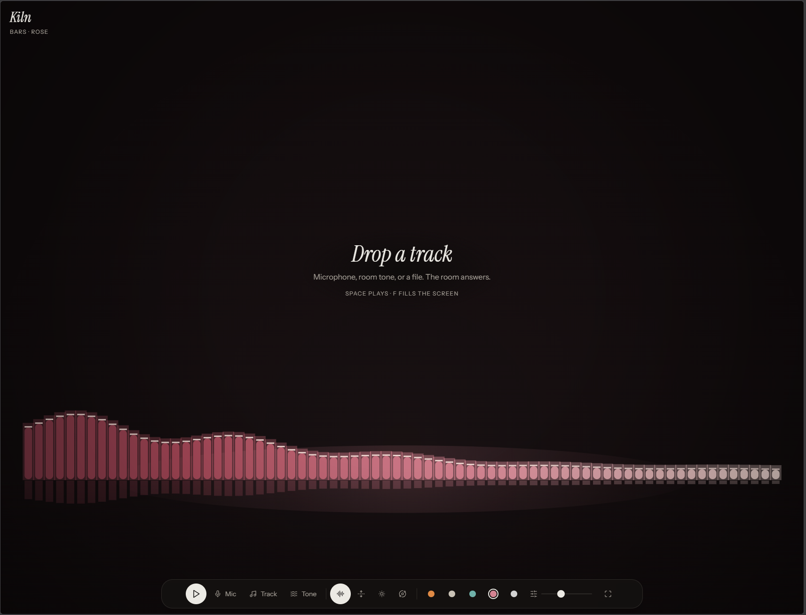
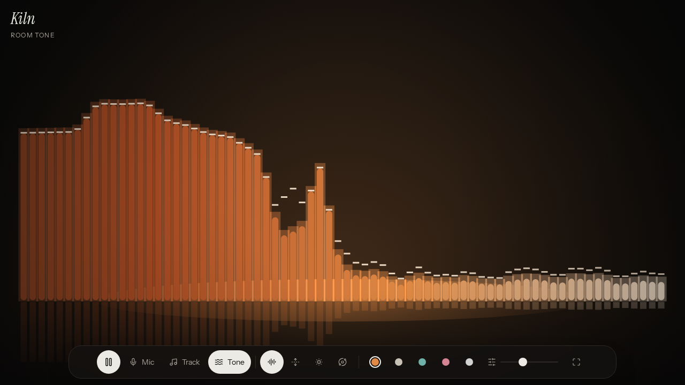
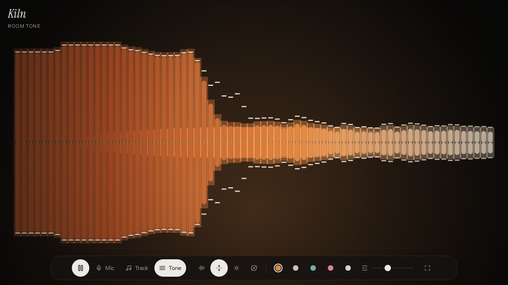
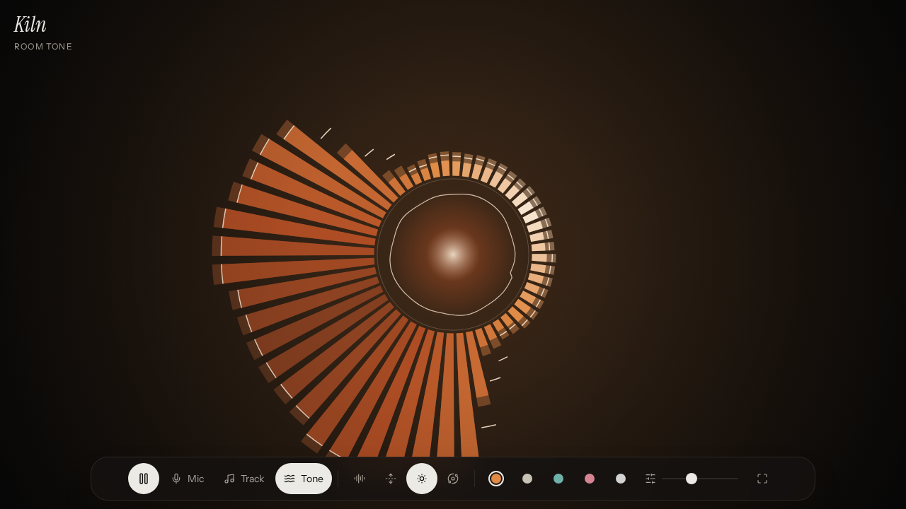
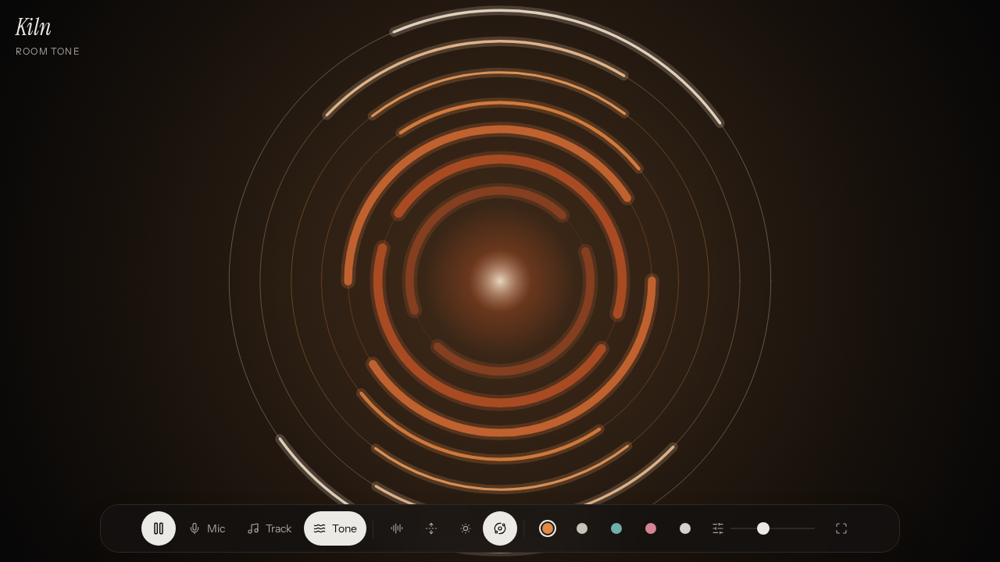
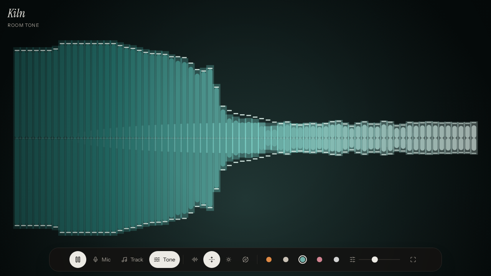

# Kiln

A full-screen audio visualizer for the browser. Point it at your microphone, drop in a track, or let the built-in room tone play, and Kiln draws the sound on a canvas.



## Features

- **Three sound sources:** live microphone input, a local audio file (MP3, WAV, OGG, M4A, AAC, FLAC, WebM), or _Room tone_, a short synthesized loop (kick, bass, pads, arpeggio) generated in the browser so there's something to look at without any input.
- **Four visualization modes:** Bars, Mirror, Radial and Rings.
- **Five color themes:** Ember, Limestone, Tide, Rose and Ink.
- **Adjustable sensitivity** with a slider.
- **Drag and drop** an audio file anywhere on the page, with a seek bar and time display for file playback.
- **Distraction-free:** the controls fade out after a few seconds of playback and come back when you move the pointer. Fullscreen is one key away.
- **Remembers your settings:** mode, theme and sensitivity are saved in `localStorage`.
- **Respects `prefers-reduced-motion`** and scales the number of bars to the screen width.
- **Fully client-side:** audio is analysed with the Web Audio API in the browser and is never uploaded anywhere.

### Keyboard shortcuts

| Key                         | Action                                             |
| --------------------------- | -------------------------------------------------- |
| <kbd>Space</kbd>            | Play / pause (stops the microphone when it's live) |
| <kbd>F</kbd>                | Toggle fullscreen                                  |
| <kbd>M</kbd>                | Next visualization mode                            |
| <kbd>1</kbd>–<kbd>4</kbd>   | Bars / Mirror / Radial / Rings                     |
| <kbd>T</kbd>                | Next color theme                                   |
| <kbd>[</kbd> / <kbd>]</kbd> | Lower / raise sensitivity                          |
| <kbd>←</kbd> / <kbd>→</kbd> | Seek 5 s back / forward (file playback)            |

## Gallery

| Bars                                                               | Mirror                                           |
| ------------------------------------------------------------------ | ------------------------------------------------ |
|                        |  |
| **Radial**                                                         | **Rings**                                        |
|                    |    |
| **Mirror, Tide theme**                                             |                                                  |
|  |                                                  |

## Tech stack

- [React 19](https://react.dev) + TypeScript
- [TanStack Start](https://tanstack.com/start) and [TanStack Router](https://tanstack.com/router) on [Vite](https://vite.dev)
- [Tailwind CSS v4](https://tailwindcss.com)
- Canvas 2D + Web Audio API (`AnalyserNode`) for the visuals
- [Nitro](https://nitro.build) with the Vercel preset for production builds
- [Lucide](https://lucide.dev) icons

## Getting started

### Prerequisites

- Node.js 22.12 or newer (see `.nvmrc`)
- npm

### Install and run

```bash
npm install
npm run dev
```

Then open <http://localhost:8080>. Microphone access needs a secure context, which `localhost` counts as.

### Scripts

| Command             | What it does                                  |
| ------------------- | --------------------------------------------- |
| `npm run dev`       | Start the dev server on port 8080             |
| `npm run build`     | Production build (output in `.vercel/output`) |
| `npm run preview`   | Serve the production build on port 8081       |
| `npm run typecheck` | Type-check with `tsc`                         |
| `npm run lint`      | Lint with ESLint                              |
| `npm run format`    | Format with Prettier                          |

### Environment variables

None. Kiln runs entirely in the browser and needs no API keys or configuration.

## Deploying to Vercel

The production build uses Nitro's Vercel preset and writes a ready-to-deploy [Build Output API](https://vercel.com/docs/build-output-api) bundle to `.vercel/output`.

- **From Git:** import the repository in Vercel. The defaults work; `vercel.json` sets the install command.
- **From the CLI:**

  ```bash
  npm run build
  npx vercel deploy --prebuilt
  ```

## Project structure

```
.
├── docs/                  # README images
├── public/                # Static assets (favicon, social card image)
├── src/
│   ├── components/
│   │   └── kiln.tsx       # The player UI: sources, modes, themes, shortcuts, drag & drop
│   ├── lib/
│   │   ├── viz.ts         # VizEngine: Web Audio graph, room-tone synth, canvas renderers, themes
│   │   └── error-component.tsx
│   ├── routes/
│   │   ├── __root.tsx     # HTML shell, meta tags, fonts
│   │   └── index.tsx      # Renders <Kiln />
│   ├── router.tsx
│   ├── routeTree.gen.ts   # Generated by TanStack Router
│   └── styles.css         # Tailwind theme and custom styles
├── vite.config.ts
└── vercel.json
```

## License

[MIT](LICENSE) © 2026 Mathias
